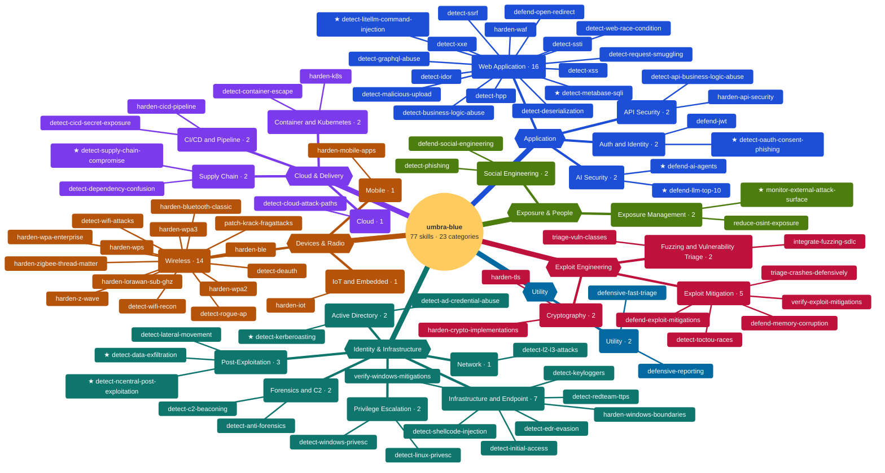

# umbra-blue · Library Mindmap

Every skill in the library, grouped by domain and category. **★** marks Tier 1 skills.

<!-- Generated by tools/build_manifest.py. Do not edit by hand. -->

**77 skills** · **23 categories** · **10 Tier 1**

[Full map](#full-map) · [Tier 1](#tier-1) · [Application](#application) · [Identity & Infrastructure](#identity--infrastructure) · [Cloud & Delivery](#cloud--delivery) · [Devices & Radio](#devices--radio) · [Exploit Engineering](#exploit-engineering) · [Exposure & People](#exposure--people) · [Utility](#utility)

## Full map

Hexagons are domains, rounded nodes are categories, leaves are skills. ★ marks Tier 1.

## Tier 1

| Skill | Category |
| --- | --- |
| `detect-litellm-command-injection` | Web Application |
| `detect-metabase-sqli` | Web Application |
| `detect-oauth-consent-phishing` | Auth and Identity |
| `defend-ai-agents` | AI Security |
| `defend-llm-top-10` | AI Security |
| `detect-kerberoasting` | Active Directory |
| `detect-data-exfiltration` | Post-Exploitation |
| `detect-ncentral-post-exploitation` | Post-Exploitation |
| `detect-supply-chain-compromise` | Supply Chain |
| `monitor-external-attack-surface` | Exposure Management |

## Application

| Category | # | Skills |
| --- | ---: | --- |
| **Web Application** | 16 | ★ `detect-litellm-command-injection` · ★ `detect-metabase-sqli` · `defend-open-redirect` · `detect-business-logic-abuse` · `detect-deserialization` · `detect-graphql-abuse` · `detect-hpp` · `detect-idor` · `detect-malicious-upload` · `detect-request-smuggling` · `detect-ssrf` · `detect-ssti` · `detect-web-race-condition` · `detect-xss` · `detect-xxe` · `harden-waf` |
| **API Security** | 2 | `detect-api-business-logic-abuse` · `harden-api-security` |
| **Auth and Identity** | 2 | ★ `detect-oauth-consent-phishing` · `defend-jwt` |
| **AI Security** | 2 | ★ `defend-ai-agents` · ★ `defend-llm-top-10` |

## Identity & Infrastructure

| Category | # | Skills |
| --- | ---: | --- |
| **Active Directory** | 2 | ★ `detect-kerberoasting` · `detect-ad-credential-abuse` |
| **Infrastructure and Endpoint** | 7 | `detect-edr-evasion` · `detect-initial-access` · `detect-keyloggers` · `detect-redteam-ttps` · `detect-shellcode-injection` · `harden-windows-boundaries` · `verify-windows-mitigations` |
| **Network** | 1 | `detect-l2-l3-attacks` |
| **Privilege Escalation** | 2 | `detect-linux-privesc` · `detect-windows-privesc` |
| **Post-Exploitation** | 3 | ★ `detect-data-exfiltration` · ★ `detect-ncentral-post-exploitation` · `detect-lateral-movement` |
| **Forensics and C2** | 2 | `detect-anti-forensics` · `detect-c2-beaconing` |

## Cloud & Delivery

| Category | # | Skills |
| --- | ---: | --- |
| **Cloud** | 1 | `detect-cloud-attack-paths` |
| **Container and Kubernetes** | 2 | `detect-container-escape` · `harden-k8s` |
| **CI/CD and Pipeline** | 2 | `detect-cicd-secret-exposure` · `harden-cicd-pipeline` |
| **Supply Chain** | 2 | ★ `detect-supply-chain-compromise` · `detect-dependency-confusion` |

## Devices & Radio

| Category | # | Skills |
| --- | ---: | --- |
| **Wireless** | 14 | `detect-deauth` · `detect-rogue-ap` · `detect-wifi-attacks` · `detect-wifi-recon` · `harden-ble` · `harden-bluetooth-classic` · `harden-lorawan-sub-ghz` · `harden-wpa-enterprise` · `harden-wpa2` · `harden-wpa3` · `harden-wps` · `harden-z-wave` · `harden-zigbee-thread-matter` · `patch-krack-fragattacks` |
| **Mobile** | 1 | `harden-mobile-apps` |
| **IoT and Embedded** | 1 | `harden-iot` |

## Exploit Engineering

| Category | # | Skills |
| --- | ---: | --- |
| **Exploit Mitigation** | 5 | `defend-exploit-mitigations` · `defend-memory-corruption` · `detect-toctou-races` · `triage-crashes-defensively` · `verify-exploit-mitigations` |
| **Fuzzing and Vulnerability Triage** | 2 | `integrate-fuzzing-sdlc` · `triage-vuln-classes` |
| **Cryptography** | 2 | `harden-crypto-implementations` · `harden-tls` |

## Exposure & People

| Category | # | Skills |
| --- | ---: | --- |
| **Exposure Management** | 2 | ★ `monitor-external-attack-surface` · `reduce-osint-exposure` |
| **Social Engineering** | 2 | `defend-social-engineering` · `detect-phishing` |

## Utility

| Category | # | Skills |
| --- | ---: | --- |
| **Utility** | 2 | `defensive-fast-triage` · `defensive-reporting` |
