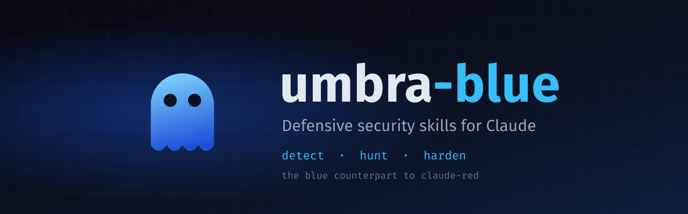

<div align="center">

# umbra-blue

**Defensive security skills for Claude - drop-in `SKILL.md` files that turn Claude into an evidence-backed blue team analyst.**

<!-- badges:start -->
[](LICENSE)
[](#skill-index)
[](#categories)
[](#two-tiers)
[](#two-tiers)
[](https://github.com/umbrasec-labs/umbra-blue)
<!-- badges:end -->

[Overview](#overview) &bull; [Blue Team Mapper](#blue-team-mapper) &bull; [Quickstart](#quickstart) &bull; [Two tiers](#two-tiers) &bull; [Categories](#categories) &bull; [Skill Index](#skill-index) &bull; [Coverage](COVERAGE.md) &bull; [Roadmap](#roadmap) &bull; [Contributing](#contributing)

</div>

---

## Overview

`umbra-blue` is a library of defensive security skills for the [Claude Skills system](https://code.claude.com/docs/en/skills). It is the blue team counterpart to [claude-red](https://github.com/SnailSploit/claude-red): every one of claude-red's offensive skills is paired with the defensive skill that answers it, in the same category folder. Where claude-red teaches Claude how a technique is executed, umbra-blue teaches Claude how to see it, hunt it, and shut it down.

Each skill is a structured `SKILL.md` that primes Claude with detection, hunting, and hardening methodology for one threat: the log sources and event IDs that carry the signal, what to alert on, how to tune out false positives, how to hunt for the quiet variant, and which controls shrink the attack surface, mapped to MITRE ATT&CK and D3FEND. Skills load on demand from their description triggers, so you only pay context for the skill you need.

**What makes it different:** most blue team skill collections teach method, such as how to write a Sigma rule. umbra-blue's Tier 1 skills ship the tuned rule itself, drawn from published [UMBRASEC](https://umbrasec.dev) incident research and reused byte for byte from the [UMBRASEC sigma-pack](https://umbrasec.dev/tools/sigma-pack/), with tuning and false-positive notes. Every skill says plainly which tier it is in, and none fabricates a rule or a citation.

**Use cases:** SOC triage and alert investigation, detection engineering, threat hunting, hardening reviews, purple team exercises against claude-red, incident response support, and defender training.

**Defensive in scope.** Skills explain a technique only to the depth needed to detect and mitigate it. No exploit code, payloads, or offensive tooling ship from here.

---

## Blue Team Mapper

Every skill has its own page in the [Blue Team Mapper](https://umbrasec-labs.github.io/BlueTeamMapper/), the UMBRASEC interactive map of defensive operations. Use it to see where a skill fits before you load it, or to plan a purple team exercise. A skill's page shows:

- the ATT&CK techniques the skill covers and the claude-red skills it answers
- the UMBRASEC sigma-pack rules it inlines, plus other UMBRASEC rules for the same techniques

Where the skill's techniques are in the mapper matrix, the page also shows:

- the matching matrix rows
- the response flow chains those rows lead to
- your own coverage rating for each row, if you set one on the mapper's Coverage page

The matrix covers a focused set of techniques, so many skills have no matrix rows yet. Their pages still list the techniques and any matching rules.

Follow the **map** link next to any skill in the [Skill Index](#skill-index) or [COVERAGE.md](COVERAGE.md). Each page lives at `https://umbrasec-labs.github.io/BlueTeamMapper/skills/<skill-name>`, and `claude-skills.json` carries the same URL in each skill's `mapper` field.

---

## Quickstart

### Claude Code (recommended)

Claude Code discovers skills at `~/.claude/skills/<skill-name>/SKILL.md`, one folder per skill, so use the installer. It flattens the category tree into that layout.

```bash
git clone https://github.com/umbrasec-labs/umbra-blue
cd umbra-blue
./install.sh                          # all skills into ~/.claude/skills
./install.sh --category web           # one category (repeatable)
./install.sh --tier 1                 # only the sourced Tier 1 skills
./install.sh --project                # into ./.claude/skills for one project
./install.sh --list                   # categories and counts
./install.sh --uninstall              # remove every umbra-blue skill
```

The installer never overwrites a skill it did not install unless you pass `--force`. To update, `git pull` and run it again: it refreshes the umbra-blue skills and removes any that were renamed or dropped since your last install. Start a new session and Claude loads a matching skill from its triggers: mentioning Kerberoasting or RC4 service tickets loads `detect-kerberoasting`.

### Claude.ai

Zip a single skill folder, for example `Skills/web/detect-xss/`, and upload it under Customize, then Skills. Every skill uses only the `name` and `description` frontmatter keys, and every description fits the 1,024-character limit, so uploads pass validation.

### Any LLM

Paste the contents of a `SKILL.md` into a system prompt or project instructions.

---

## Two tiers

umbra-blue mirrors all of claude-red, so it ships in two clearly labeled tiers. The tier is visible at the top of every skill before you trust it.

| Tier | What you get |
|---|---|
| **1, sourced** | Built from a published UMBRASEC writeup or tool and cites primary sources. Ships a runnable detection or hunt; where that is a rule, it is reused byte for byte from the UMBRASEC sigma-pack. |
| **2, methodology** | The defender's method, log sources and signals, hunt, and hardening, pointing to public rule sources such as SigmaHQ and vendor analytics. A banner states that no bespoke UMBRASEC rule ships yet. |

A Tier 2 skill is promoted to Tier 1 when its UMBRASEC writeup and tuned rule land. The one rule no tier may break: never invent a rule or a citation. See [PRINCIPLES.md](PRINCIPLES.md).

---

## Categories

The category folders match claude-red's, so each offensive skill and its defensive answer sit side by side.

<!-- categories:start -->
| Category | Skills | Tier 1 | Focus |
|---|---:|---:|---|
| [Web Application](#web-application) | 16 | 2 | Detection and hardening for the OWASP Top 10 and advanced web vulnerability classes |
| [Auth & Identity](#auth--identity) | 2 | 1 | JWT validation hardening, OAuth and OIDC consent-grant detection |
| [Active Directory](#active-directory) | 2 | 1 | Kerberoasting, AS-REP roasting, DCSync, and ACL abuse detection |
| [Wireless](#wireless) | 14 | 0 | 802.11, WPA2/3, EAP, WPS, BLE, Zigbee, Z-Wave, LoRa, and sub-GHz detection and hardening |
| [Cloud](#cloud) | 1 | 0 | Control-plane and IAM attack-path detection across AWS, Azure, and GCP |
| [Mobile](#mobile) | 1 | 0 | Android and iOS application hardening |
| [IoT & Embedded](#iot--embedded) | 1 | 0 | Firmware, hardware-interface, RTOS, and ICS/OT hardening |
| [Infrastructure & Endpoint](#infrastructure--endpoint) | 7 | 0 | Initial access, EDR tampering, injection, and red-team TTP detection, Windows hardening |
| [Exploit Mitigation](#exploit-mitigation) | 5 | 0 | Memory-safety hardening and exploit-mitigation verification |
| [Fuzzing & Vulnerability Triage](#fuzzing--vulnerability-triage) | 2 | 0 | Fuzzing in the SDLC and bug-class triage |
| [Exposure Management](#exposure-management) | 2 | 1 | External attack surface monitoring and OSINT exposure reduction |
| [API Security](#api-security) | 2 | 0 | API abuse detection and gateway hardening |
| [Container & Kubernetes](#container--kubernetes) | 2 | 0 | Container-escape detection and cluster hardening |
| [CI/CD & Pipeline](#cicd--pipeline) | 2 | 0 | Pipeline hardening and secret-exposure detection |
| [Cryptography](#cryptography) | 2 | 0 | TLS and cryptographic implementation hardening |
| [Privilege Escalation](#privilege-escalation) | 2 | 0 | Linux and Windows privilege-escalation detection |
| [Post-Exploitation](#post-exploitation) | 3 | 2 | Lateral movement, persistence, and exfiltration detection |
| [Forensics & C2](#forensics--c2) | 2 | 0 | Anti-forensics and command-and-control beaconing detection |
| [Supply Chain](#supply-chain) | 2 | 1 | Compromised-package and dependency-confusion detection |
| [Social Engineering](#social-engineering) | 2 | 0 | Phishing detection and human-layer controls |
| [Network](#network) | 1 | 0 | Layer 2 and 3 poisoning and MITM detection |
| [AI Security](#ai-security) | 2 | 2 | OWASP LLM Top 10 and tool-calling agent defenses |
| [Utility](#utility) | 2 | 0 | Fast defensive triage and evidence-backed reporting |
<!-- categories:end -->

---

## Skill Index

Tier 1 skills are listed first in each category. The full red-to-blue pairing is in [COVERAGE.md](COVERAGE.md), and a visual map is in [MINDMAP.md](MINDMAP.md). Each **map** link opens that skill's page in the [Blue Team Mapper](#blue-team-mapper).

<!-- skill-index:start -->
### Web Application

`Skills/web/`

| Skill | Tier | Answers claude-red | Defensive focus | Mapper |
|---|:-:|---|---|:-:|
| [`detect-litellm-command-injection`](Skills/web/detect-litellm-command-injection/SKILL.md) | 1 | `offensive-rce` | LiteLLM proxy RCE (CVE-2026-42271) detection, host and web signals | [map](https://umbrasec-labs.github.io/BlueTeamMapper/skills/detect-litellm-command-injection) |
| [`detect-metabase-sqli`](Skills/web/detect-metabase-sqli/SKILL.md) | 1 | `offensive-sqli` | Unauthenticated SQLi detection from the Metabase CVE-2026-72898 case | [map](https://umbrasec-labs.github.io/BlueTeamMapper/skills/detect-metabase-sqli) |
| [`defend-open-redirect`](Skills/web/defend-open-redirect/SKILL.md) | 2 | `offensive-open-redirect` | Redirect allowlisting, token-leak prevention | [map](https://umbrasec-labs.github.io/BlueTeamMapper/skills/defend-open-redirect) |
| [`detect-business-logic-abuse`](Skills/web/detect-business-logic-abuse/SKILL.md) | 2 | `offensive-business-logic` | Workflow-bypass and pricing-abuse monitoring | [map](https://umbrasec-labs.github.io/BlueTeamMapper/skills/detect-business-logic-abuse) |
| [`detect-deserialization`](Skills/web/detect-deserialization/SKILL.md) | 2 | `offensive-deserialization` | Gadget-chain and untrusted-stream indicators | [map](https://umbrasec-labs.github.io/BlueTeamMapper/skills/detect-deserialization) |
| [`detect-graphql-abuse`](Skills/web/detect-graphql-abuse/SKILL.md) | 2 | `offensive-graphql` | Introspection lockdown, batching and alias-abuse limits | [map](https://umbrasec-labs.github.io/BlueTeamMapper/skills/detect-graphql-abuse) |
| [`detect-hpp`](Skills/web/detect-hpp/SKILL.md) | 2 | `offensive-parameter-pollution` | Duplicate-parameter and WAF-confusion detection | [map](https://umbrasec-labs.github.io/BlueTeamMapper/skills/detect-hpp) |
| [`detect-idor`](Skills/web/detect-idor/SKILL.md) | 2 | `offensive-idor` | Authorization-failure and object-enumeration signals | [map](https://umbrasec-labs.github.io/BlueTeamMapper/skills/detect-idor) |
| [`detect-malicious-upload`](Skills/web/detect-malicious-upload/SKILL.md) | 2 | `offensive-file-upload` | Upload content inspection, webshell and polyglot detection | [map](https://umbrasec-labs.github.io/BlueTeamMapper/skills/detect-malicious-upload) |
| [`detect-request-smuggling`](Skills/web/detect-request-smuggling/SKILL.md) | 2 | `offensive-request-smuggling` | CL.TE / TE.CL desync signatures and front-end hardening | [map](https://umbrasec-labs.github.io/BlueTeamMapper/skills/detect-request-smuggling) |
| [`detect-ssrf`](Skills/web/detect-ssrf/SKILL.md) | 2 | `offensive-ssrf` | Metadata-endpoint access, egress anomaly, allowlist bypass | [map](https://umbrasec-labs.github.io/BlueTeamMapper/skills/detect-ssrf) |
| [`detect-ssti`](Skills/web/detect-ssti/SKILL.md) | 2 | `offensive-ssti` | Template-engine error and payload signatures | [map](https://umbrasec-labs.github.io/BlueTeamMapper/skills/detect-ssti) |
| [`detect-web-race-condition`](Skills/web/detect-web-race-condition/SKILL.md) | 2 | `offensive-race-condition` | Single-packet and limit-bypass anomaly detection | [map](https://umbrasec-labs.github.io/BlueTeamMapper/skills/detect-web-race-condition) |
| [`detect-xss`](Skills/web/detect-xss/SKILL.md) | 2 | `offensive-xss` | CSP, output-encoding gaps, DOM-sink monitoring | [map](https://umbrasec-labs.github.io/BlueTeamMapper/skills/detect-xss) |
| [`detect-xxe`](Skills/web/detect-xxe/SKILL.md) | 2 | `offensive-xxe` | External-entity and OOB callback detection | [map](https://umbrasec-labs.github.io/BlueTeamMapper/skills/detect-xxe) |
| [`harden-waf`](Skills/web/harden-waf/SKILL.md) | 2 | `offensive-waf-bypass` | Encoding and chunked-transfer evasion coverage, rule tuning | [map](https://umbrasec-labs.github.io/BlueTeamMapper/skills/harden-waf) |

### Auth & Identity

`Skills/auth/`

| Skill | Tier | Answers claude-red | Defensive focus | Mapper |
|---|:-:|---|---|:-:|
| [`detect-oauth-consent-phishing`](Skills/auth/detect-oauth-consent-phishing/SKILL.md) | 1 | `offensive-oauth` | Illicit consent grants and app-role abuse in Entra ID via KQL | [map](https://umbrasec-labs.github.io/BlueTeamMapper/skills/detect-oauth-consent-phishing) |
| [`defend-jwt`](Skills/auth/defend-jwt/SKILL.md) | 2 | `offensive-jwt` | Reject alg:none and key confusion, enforce validation and key rotation | [map](https://umbrasec-labs.github.io/BlueTeamMapper/skills/defend-jwt) |

### Active Directory

`Skills/active-directory/`

| Skill | Tier | Answers claude-red | Defensive focus | Mapper |
|---|:-:|---|---|:-:|
| [`detect-kerberoasting`](Skills/active-directory/detect-kerberoasting/SKILL.md) | 1 | `offensive-active-directory` | RC4 service-ticket downgrade, SPN fan-out, honeypot SPN via Event 4769 | [map](https://umbrasec-labs.github.io/BlueTeamMapper/skills/detect-kerberoasting) |
| [`detect-ad-credential-abuse`](Skills/active-directory/detect-ad-credential-abuse/SKILL.md) | 2 | `offensive-active-directory` | ASREProast, DCSync, ACL and delegation abuse, MDI alerts | [map](https://umbrasec-labs.github.io/BlueTeamMapper/skills/detect-ad-credential-abuse) |

### Wireless

`Skills/wireless/`

| Skill | Tier | Answers claude-red | Defensive focus | Mapper |
|---|:-:|---|---|:-:|
| [`detect-deauth`](Skills/wireless/detect-deauth/SKILL.md) | 2 | `offensive-deauth-disassoc` | Deauth/disassoc flood detection, 802.11w | [map](https://umbrasec-labs.github.io/BlueTeamMapper/skills/detect-deauth) |
| [`detect-rogue-ap`](Skills/wireless/detect-rogue-ap/SKILL.md) | 2 | `offensive-evil-twin` | Rogue and evil-twin AP detection | [map](https://umbrasec-labs.github.io/BlueTeamMapper/skills/detect-rogue-ap) |
| [`detect-wifi-attacks`](Skills/wireless/detect-wifi-attacks/SKILL.md) | 2 | `offensive-wifi` | 802.11 attack detection overview | [map](https://umbrasec-labs.github.io/BlueTeamMapper/skills/detect-wifi-attacks) |
| [`detect-wifi-recon`](Skills/wireless/detect-wifi-recon/SKILL.md) | 2 | `offensive-wifi-recon` | Rogue-scan and probe-flood detection | [map](https://umbrasec-labs.github.io/BlueTeamMapper/skills/detect-wifi-recon) |
| [`harden-ble`](Skills/wireless/harden-ble/SKILL.md) | 2 | `offensive-bluetooth-ble` | GATT access control, pairing hardening | [map](https://umbrasec-labs.github.io/BlueTeamMapper/skills/harden-ble) |
| [`harden-bluetooth-classic`](Skills/wireless/harden-bluetooth-classic/SKILL.md) | 2 | `offensive-bluetooth-classic` | Discovery and SDP exposure reduction | [map](https://umbrasec-labs.github.io/BlueTeamMapper/skills/harden-bluetooth-classic) |
| [`harden-lorawan-sub-ghz`](Skills/wireless/harden-lorawan-sub-ghz/SKILL.md) | 2 | `offensive-lorawan-sub-ghz` | Join-procedure and session-key hardening | [map](https://umbrasec-labs.github.io/BlueTeamMapper/skills/harden-lorawan-sub-ghz) |
| [`harden-wpa-enterprise`](Skills/wireless/harden-wpa-enterprise/SKILL.md) | 2 | `offensive-wpa-enterprise` | 802.1X/EAP server-cert validation, anti-rogue-RADIUS | [map](https://umbrasec-labs.github.io/BlueTeamMapper/skills/harden-wpa-enterprise) |
| [`harden-wpa2`](Skills/wireless/harden-wpa2/SKILL.md) | 2 | `offensive-wpa2-psk` | PSK handshake-capture resistance, strong passphrase policy | [map](https://umbrasec-labs.github.io/BlueTeamMapper/skills/harden-wpa2) |
| [`harden-wpa3`](Skills/wireless/harden-wpa3/SKILL.md) | 2 | `offensive-wpa3-sae` | SAE transition-mode and downgrade hardening | [map](https://umbrasec-labs.github.io/BlueTeamMapper/skills/harden-wpa3) |
| [`harden-wps`](Skills/wireless/harden-wps/SKILL.md) | 2 | `offensive-wps` | Disable WPS, Pixie-Dust exposure checks | [map](https://umbrasec-labs.github.io/BlueTeamMapper/skills/harden-wps) |
| [`harden-z-wave`](Skills/wireless/harden-z-wave/SKILL.md) | 2 | `offensive-z-wave` | S0/S2 key and sniffing exposure hardening | [map](https://umbrasec-labs.github.io/BlueTeamMapper/skills/harden-z-wave) |
| [`harden-zigbee-thread-matter`](Skills/wireless/harden-zigbee-thread-matter/SKILL.md) | 2 | `offensive-zigbee-thread-matter` | Mesh-protocol key management and monitoring | [map](https://umbrasec-labs.github.io/BlueTeamMapper/skills/harden-zigbee-thread-matter) |
| [`patch-krack-fragattacks`](Skills/wireless/patch-krack-fragattacks/SKILL.md) | 2 | `offensive-krack-fragattacks` | KRACK and FragAttacks patch and exposure verification | [map](https://umbrasec-labs.github.io/BlueTeamMapper/skills/patch-krack-fragattacks) |

### Cloud

`Skills/cloud/`

| Skill | Tier | Answers claude-red | Defensive focus | Mapper |
|---|:-:|---|---|:-:|
| [`detect-cloud-attack-paths`](Skills/cloud/detect-cloud-attack-paths/SKILL.md) | 2 | `offensive-cloud` | IAM anomaly and control-plane log detection across AWS, Azure, GCP | [map](https://umbrasec-labs.github.io/BlueTeamMapper/skills/detect-cloud-attack-paths) |

### Mobile

`Skills/mobile/`

| Skill | Tier | Answers claude-red | Defensive focus | Mapper |
|---|:-:|---|---|:-:|
| [`harden-mobile-apps`](Skills/mobile/harden-mobile-apps/SKILL.md) | 2 | `offensive-mobile` | Static and runtime hardening for Android and iOS apps | [map](https://umbrasec-labs.github.io/BlueTeamMapper/skills/harden-mobile-apps) |

### IoT & Embedded

`Skills/iot/`

| Skill | Tier | Answers claude-red | Defensive focus | Mapper |
|---|:-:|---|---|:-:|
| [`harden-iot`](Skills/iot/harden-iot/SKILL.md) | 2 | `offensive-iot` | Firmware, hardware-interface, and RTOS/ICS hardening | [map](https://umbrasec-labs.github.io/BlueTeamMapper/skills/harden-iot) |

### Infrastructure & Endpoint

`Skills/infrastructure/`

| Skill | Tier | Answers claude-red | Defensive focus | Mapper |
|---|:-:|---|---|:-:|
| [`detect-edr-evasion`](Skills/infrastructure/detect-edr-evasion/SKILL.md) | 2 | `offensive-edr-evasion` | AMSI and ETW tamper detection, unhooking indicators | [map](https://umbrasec-labs.github.io/BlueTeamMapper/skills/detect-edr-evasion) |
| [`detect-initial-access`](Skills/infrastructure/detect-initial-access/SKILL.md) | 2 | `offensive-initial-access` | Public-facing exploit and payload-delivery detection, from the Metabase and N-central cases | [map](https://umbrasec-labs.github.io/BlueTeamMapper/skills/detect-initial-access) |
| [`detect-keyloggers`](Skills/infrastructure/detect-keyloggers/SKILL.md) | 2 | `offensive-keylogger-arch` | Input-capture and hook-install detection | [map](https://umbrasec-labs.github.io/BlueTeamMapper/skills/detect-keyloggers) |
| [`detect-redteam-ttps`](Skills/infrastructure/detect-redteam-ttps/SKILL.md) | 2 | `offensive-advanced-redteam` | Purple-team detection coverage across the engagement lifecycle | [map](https://umbrasec-labs.github.io/BlueTeamMapper/skills/detect-redteam-ttps) |
| [`detect-shellcode-injection`](Skills/infrastructure/detect-shellcode-injection/SKILL.md) | 2 | `offensive-shellcode` | Injection and in-memory execution detection | [map](https://umbrasec-labs.github.io/BlueTeamMapper/skills/detect-shellcode-injection) |
| [`harden-windows-boundaries`](Skills/infrastructure/harden-windows-boundaries/SKILL.md) | 2 | `offensive-windows-boundaries` | Trust-boundary and token hardening | [map](https://umbrasec-labs.github.io/BlueTeamMapper/skills/harden-windows-boundaries) |
| [`verify-windows-mitigations`](Skills/infrastructure/verify-windows-mitigations/SKILL.md) | 2 | `offensive-windows-mitigations` | Confirm exploit mitigations are enforced | [map](https://umbrasec-labs.github.io/BlueTeamMapper/skills/verify-windows-mitigations) |

### Exploit Mitigation

`Skills/exploit-dev/`

| Skill | Tier | Answers claude-red | Defensive focus | Mapper |
|---|:-:|---|---|:-:|
| [`defend-exploit-mitigations`](Skills/exploit-dev/defend-exploit-mitigations/SKILL.md) | 2 | `offensive-exploit-development` | ASLR, DEP, CFG, CET coverage and gaps | [map](https://umbrasec-labs.github.io/BlueTeamMapper/skills/defend-exploit-mitigations) |
| [`defend-memory-corruption`](Skills/exploit-dev/defend-memory-corruption/SKILL.md) | 2 | `offensive-basic-exploitation`, `offensive-exploit-dev-course` | Compiler and allocator hardening for memory safety | [map](https://umbrasec-labs.github.io/BlueTeamMapper/skills/defend-memory-corruption) |
| [`detect-toctou-races`](Skills/exploit-dev/detect-toctou-races/SKILL.md) | 2 | `offensive-toctou` | TOCTOU and race-window hardening | [map](https://umbrasec-labs.github.io/BlueTeamMapper/skills/detect-toctou-races) |
| [`triage-crashes-defensively`](Skills/exploit-dev/triage-crashes-defensively/SKILL.md) | 2 | `offensive-crash-analysis` | Exploitability triage of crashes for defenders | [map](https://umbrasec-labs.github.io/BlueTeamMapper/skills/triage-crashes-defensively) |
| [`verify-exploit-mitigations`](Skills/exploit-dev/verify-exploit-mitigations/SKILL.md) | 2 | `offensive-mitigations` | Audit that mitigations are present and effective | [map](https://umbrasec-labs.github.io/BlueTeamMapper/skills/verify-exploit-mitigations) |

### Fuzzing & Vulnerability Triage

`Skills/fuzzing/`

| Skill | Tier | Answers claude-red | Defensive focus | Mapper |
|---|:-:|---|---|:-:|
| [`integrate-fuzzing-sdlc`](Skills/fuzzing/integrate-fuzzing-sdlc/SKILL.md) | 2 | `offensive-fuzzing`, `offensive-fuzzing-course` | Fuzz your own code in CI, triage findings | [map](https://umbrasec-labs.github.io/BlueTeamMapper/skills/integrate-fuzzing-sdlc) |
| [`triage-vuln-classes`](Skills/fuzzing/triage-vuln-classes/SKILL.md) | 2 | `offensive-bug-identification`, `offensive-vuln-classes` | Classify and prioritize discovered bug classes | [map](https://umbrasec-labs.github.io/BlueTeamMapper/skills/triage-vuln-classes) |

### Exposure Management

`Skills/recon/`

| Skill | Tier | Answers claude-red | Defensive focus | Mapper |
|---|:-:|---|---|:-:|
| [`monitor-external-attack-surface`](Skills/recon/monitor-external-attack-surface/SKILL.md) | 1 | `offensive-osint-methodology` | KEV exposure checks and external-surface monitoring | [map](https://umbrasec-labs.github.io/BlueTeamMapper/skills/monitor-external-attack-surface) |
| [`reduce-osint-exposure`](Skills/recon/reduce-osint-exposure/SKILL.md) | 2 | `offensive-osint` | Shrink leaked data, exposed services, and employee footprint | [map](https://umbrasec-labs.github.io/BlueTeamMapper/skills/reduce-osint-exposure) |

### API Security

`Skills/api/`

| Skill | Tier | Answers claude-red | Defensive focus | Mapper |
|---|:-:|---|---|:-:|
| [`detect-api-business-logic-abuse`](Skills/api/detect-api-business-logic-abuse/SKILL.md) | 2 | `offensive-api-abuse` | BOLA/IDOR monitoring, rate and sequence anomaly | [map](https://umbrasec-labs.github.io/BlueTeamMapper/skills/detect-api-business-logic-abuse) |
| [`harden-api-security`](Skills/api/harden-api-security/SKILL.md) | 2 | `offensive-api-security` | AuthZ, schema validation, gateway controls across REST/gRPC/WebSocket | [map](https://umbrasec-labs.github.io/BlueTeamMapper/skills/harden-api-security) |

### Container & Kubernetes

`Skills/container/`

| Skill | Tier | Answers claude-red | Defensive focus | Mapper |
|---|:-:|---|---|:-:|
| [`detect-container-escape`](Skills/container/detect-container-escape/SKILL.md) | 2 | `offensive-container-escape` | Runtime escape detection, seccomp and capability monitoring | [map](https://umbrasec-labs.github.io/BlueTeamMapper/skills/detect-container-escape) |
| [`harden-k8s`](Skills/container/harden-k8s/SKILL.md) | 2 | `offensive-k8s-attacks` | RBAC least privilege, admission control, audit-log detection | [map](https://umbrasec-labs.github.io/BlueTeamMapper/skills/harden-k8s) |

### CI/CD & Pipeline

`Skills/cicd/`

| Skill | Tier | Answers claude-red | Defensive focus | Mapper |
|---|:-:|---|---|:-:|
| [`detect-cicd-secret-exposure`](Skills/cicd/detect-cicd-secret-exposure/SKILL.md) | 2 | `offensive-cicd-secrets` | Secret scanning and rotation, pipeline leak detection | [map](https://umbrasec-labs.github.io/BlueTeamMapper/skills/detect-cicd-secret-exposure) |
| [`harden-cicd-pipeline`](Skills/cicd/harden-cicd-pipeline/SKILL.md) | 2 | `offensive-cicd-pipeline` | OIDC federation, runner isolation, workflow-injection prevention | [map](https://umbrasec-labs.github.io/BlueTeamMapper/skills/harden-cicd-pipeline) |

### Cryptography

`Skills/crypto/`

| Skill | Tier | Answers claude-red | Defensive focus | Mapper |
|---|:-:|---|---|:-:|
| [`harden-crypto-implementations`](Skills/crypto/harden-crypto-implementations/SKILL.md) | 2 | `offensive-crypto-attacks` | Fix padding, nonce reuse, and weak-primitive misuse | [map](https://umbrasec-labs.github.io/BlueTeamMapper/skills/harden-crypto-implementations) |
| [`harden-tls`](Skills/crypto/harden-tls/SKILL.md) | 2 | `offensive-tls-attacks` | Cipher and protocol hardening, config scanning | [map](https://umbrasec-labs.github.io/BlueTeamMapper/skills/harden-tls) |

### Privilege Escalation

`Skills/privesc/`

| Skill | Tier | Answers claude-red | Defensive focus | Mapper |
|---|:-:|---|---|:-:|
| [`detect-linux-privesc`](Skills/privesc/detect-linux-privesc/SKILL.md) | 2 | `offensive-linux-privesc` | SUID, capability, and sudo-abuse detection and hardening | [map](https://umbrasec-labs.github.io/BlueTeamMapper/skills/detect-linux-privesc) |
| [`detect-windows-privesc`](Skills/privesc/detect-windows-privesc/SKILL.md) | 2 | `offensive-windows-privesc` | Token, service, and UAC-bypass detection and hardening | [map](https://umbrasec-labs.github.io/BlueTeamMapper/skills/detect-windows-privesc) |

### Post-Exploitation

`Skills/post-exploitation/`

| Skill | Tier | Answers claude-red | Defensive focus | Mapper |
|---|:-:|---|---|:-:|
| [`detect-data-exfiltration`](Skills/post-exploitation/detect-data-exfiltration/SKILL.md) | 1 | `offensive-data-exfiltration` | DNS and HTTPS exfil detection, egress volume anomaly | [map](https://umbrasec-labs.github.io/BlueTeamMapper/skills/detect-data-exfiltration) |
| [`detect-ncentral-post-exploitation`](Skills/post-exploitation/detect-ncentral-post-exploitation/SKILL.md) | 1 | `offensive-persistence` | Service persistence, masquerading, and tunnel detection from the N-central case | [map](https://umbrasec-labs.github.io/BlueTeamMapper/skills/detect-ncentral-post-exploitation) |
| [`detect-lateral-movement`](Skills/post-exploitation/detect-lateral-movement/SKILL.md) | 2 | `offensive-lateral-movement` | Remote-exec, Pass-the-Hash and tunneling signals | [map](https://umbrasec-labs.github.io/BlueTeamMapper/skills/detect-lateral-movement) |

### Forensics & C2

`Skills/forensics/`

| Skill | Tier | Answers claude-red | Defensive focus | Mapper |
|---|:-:|---|---|:-:|
| [`detect-anti-forensics`](Skills/forensics/detect-anti-forensics/SKILL.md) | 2 | `offensive-anti-forensics` | Log-clear (1102), timestomp, and artifact-wipe detection | [map](https://umbrasec-labs.github.io/BlueTeamMapper/skills/detect-anti-forensics) |
| [`detect-c2-beaconing`](Skills/forensics/detect-c2-beaconing/SKILL.md) | 2 | `offensive-c2-frameworks` | Beacon jitter, JA3, and tunnel-service detection | [map](https://umbrasec-labs.github.io/BlueTeamMapper/skills/detect-c2-beaconing) |

### Supply Chain

`Skills/supply-chain/`

| Skill | Tier | Answers claude-red | Defensive focus | Mapper |
|---|:-:|---|---|:-:|
| [`detect-supply-chain-compromise`](Skills/supply-chain/detect-supply-chain-compromise/SKILL.md) | 1 | `offensive-supply-chain` | Compromised-package and tampered-artifact detection, MSP RMM risk | [map](https://umbrasec-labs.github.io/BlueTeamMapper/skills/detect-supply-chain-compromise) |
| [`detect-dependency-confusion`](Skills/supply-chain/detect-dependency-confusion/SKILL.md) | 2 | `offensive-dependency-confusion` | Namespace-takeover and resolver-order monitoring | [map](https://umbrasec-labs.github.io/BlueTeamMapper/skills/detect-dependency-confusion) |

### Social Engineering

`Skills/social-engineering/`

| Skill | Tier | Answers claude-red | Defensive focus | Mapper |
|---|:-:|---|---|:-:|
| [`defend-social-engineering`](Skills/social-engineering/defend-social-engineering/SKILL.md) | 2 | `offensive-social-engineering` | Awareness, vishing and physical controls, process hardening | [map](https://umbrasec-labs.github.io/BlueTeamMapper/skills/defend-social-engineering) |
| [`detect-phishing`](Skills/social-engineering/detect-phishing/SKILL.md) | 2 | `offensive-phishing` | Consent-phishing detection from the OAuth writeup; email-phishing controls next | [map](https://umbrasec-labs.github.io/BlueTeamMapper/skills/detect-phishing) |

### Network

`Skills/network/`

| Skill | Tier | Answers claude-red | Defensive focus | Mapper |
|---|:-:|---|---|:-:|
| [`detect-l2-l3-attacks`](Skills/network/detect-l2-l3-attacks/SKILL.md) | 2 | `offensive-network-attacks` | ARP, LLMNR, and DNS poisoning detection, DHCP snooping | [map](https://umbrasec-labs.github.io/BlueTeamMapper/skills/detect-l2-l3-attacks) |

### AI Security

`Skills/ai/`

| Skill | Tier | Answers claude-red | Defensive focus | Mapper |
|---|:-:|---|---|:-:|
| [`defend-ai-agents`](Skills/ai/defend-ai-agents/SKILL.md) | 1 | `offensive-ai-security` | Securing tool-calling agents, least-privilege tool scopes, injection containment | [map](https://umbrasec-labs.github.io/BlueTeamMapper/skills/defend-ai-agents) |
| [`defend-llm-top-10`](Skills/ai/defend-llm-top-10/SKILL.md) | 1 | `offensive-ai-security` | OWASP LLM Top 10 for defenders: prompt injection, RAG poisoning, output handling | [map](https://umbrasec-labs.github.io/BlueTeamMapper/skills/defend-llm-top-10) |

### Utility

`Skills/utility/`

| Skill | Tier | Answers claude-red | Defensive focus | Mapper |
|---|:-:|---|---|:-:|
| [`defensive-fast-triage`](Skills/utility/defensive-fast-triage/SKILL.md) | 2 | `offensive-fast-checking` | Fast blue-team triage checklist, from the Blue Team Mapper | [map](https://umbrasec-labs.github.io/BlueTeamMapper/skills/defensive-fast-triage) |
| [`defensive-reporting`](Skills/utility/defensive-reporting/SKILL.md) | 2 | `offensive-reporting` | Detection and incident reporting, every claim tied to a source | [map](https://umbrasec-labs.github.io/BlueTeamMapper/skills/defensive-reporting) |
<!-- skill-index:end -->

---

## Roadmap

| Phase | Focus | Status |
|---|---|---|
| 1 | Full mirror of claude-red, one defensive skill per offensive skill | Complete |
| 2 | Validator, manifest generator, and rule sync in CI | Complete |
| 3 | Promote Tier 2 skills to Tier 1 as UMBRASEC writeups and rules land, starting with identity, cloud, and web | In progress |
| 4 | Claude Code plugin marketplace packaging | Planned |
| 5 | Track new claude-red skills as they ship, keeping the pairing complete | Ongoing |

See [CHANGELOG.md](CHANGELOG.md) for release history.

---

## Contributing

Contributions and corrections are welcome. See [CONTRIBUTING.md](CONTRIBUTING.md) for the skill format, the tier rules, and the review process. Found a detection that misbehaves or a wrong citation? [Open an issue](https://github.com/umbrasec-labs/umbra-blue/issues). Corrections are credited.

## License

[MIT](LICENSE). The research the Tier 1 skills derive from is published free to read at [umbrasec.dev](https://umbrasec.dev/research/).

## Acknowledgements

- **Author:** [UMBRASEC](https://umbrasec.dev), an independent defensive security practice.
- **Public rule sources** referenced by Tier 2 skills: [SigmaHQ](https://github.com/SigmaHQ/sigma), [MITRE ATT&CK](https://attack.mitre.org/), and [MITRE D3FEND](https://d3fend.mitre.org/).

---

<div align="center">

*Attackers improve. Defenders should too.*

[umbrasec.dev](https://umbrasec.dev) &bull; [Research](https://umbrasec.dev/research/) &bull; [sigma-pack](https://umbrasec.dev/tools/sigma-pack/) &bull; [GitHub](https://github.com/umbrasec-labs)

</div>
